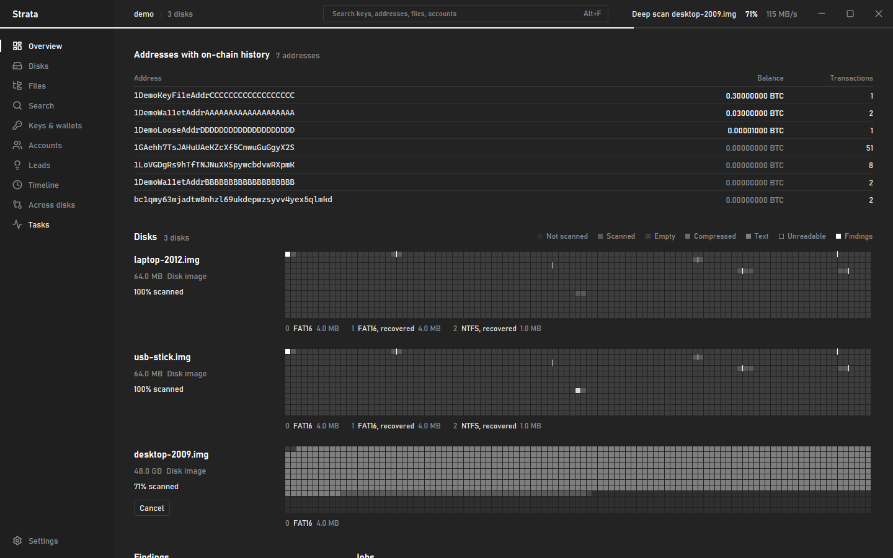
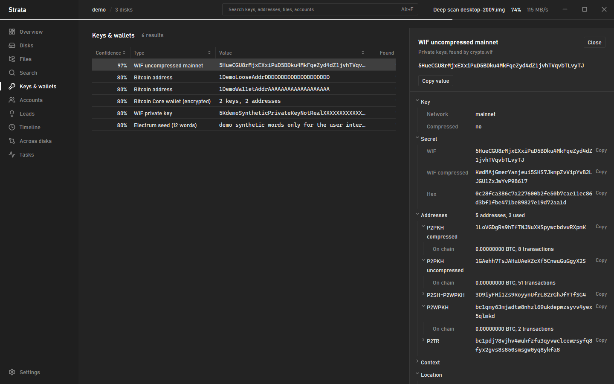
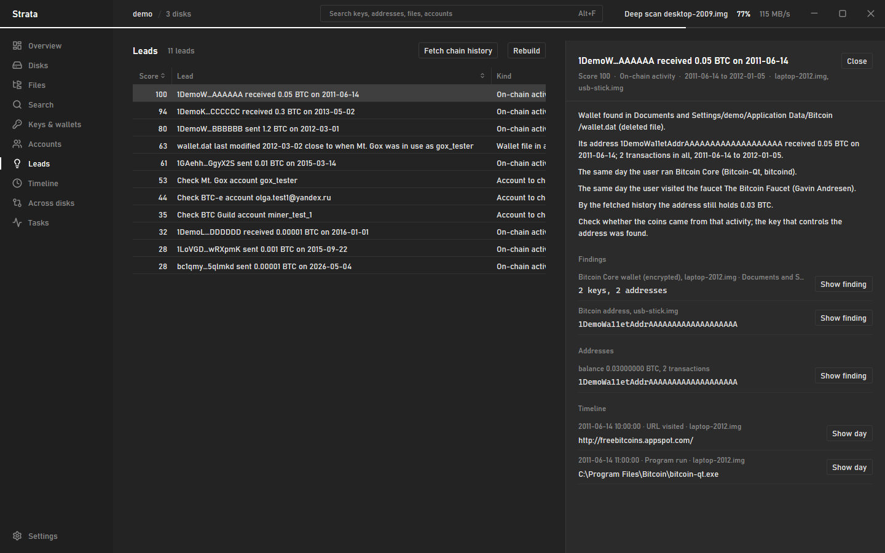
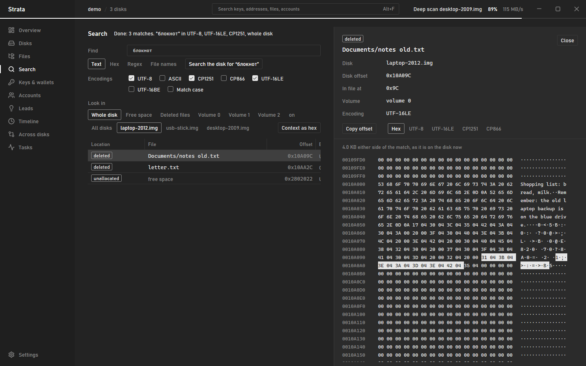
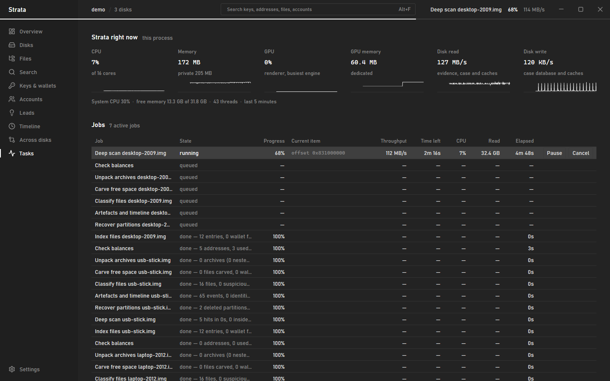
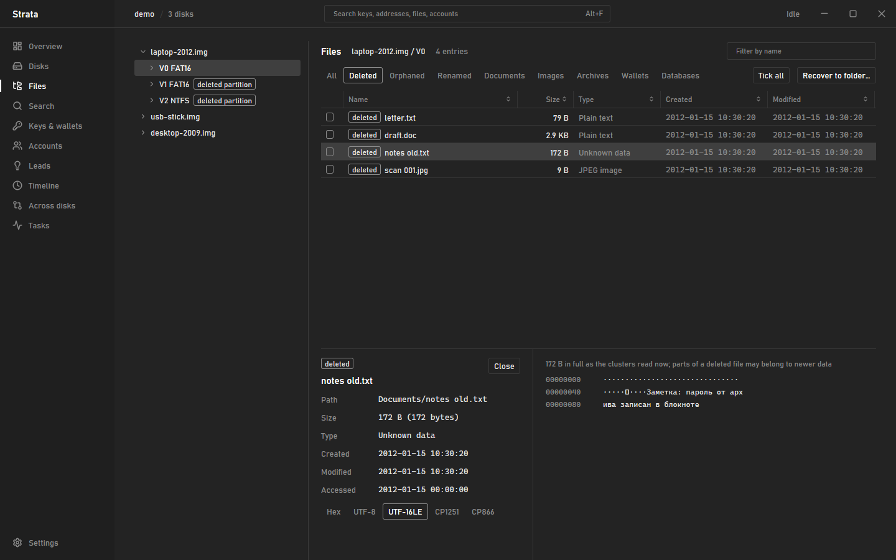

<p align="center">
  
</p>

<p align="center">
  Disk forensics and lost-wallet recovery for old drives. Rust, GPUI, read-only.
</p>

---

Strata opens disk images and physical drives, reads every byte once, and builds one map of
what was on the disk: files (live, deleted, orphaned), partitions (including deleted ones),
browser history, registry traces, accounts, and anything that looks like a Bitcoin key, seed
or wallet. Findings are tied to the exact file and offset they came from, checked against the
blockchain, and merged across several disks so you can see where one drive fills the gaps of
another.

It grew out of a pile of one-off recovery scripts. The goal is that a new disk takes one
click instead of a week of editing offsets by hand.

<p align="center">
  
</p>

## What it does

**Evidence**
- Raw images (`.img`, `.dd`, split `.001`), R-Studio images (`.rdr`, with or without `.scn`),
  EnCase `.E01`, and physical drives (`\\.\PhysicalDriveN`), always read-only.
- Bad sectors read back as zeros and are tracked as damage. Two images of the same failing
  drive are merged so one fills the other's unreadable sectors.

**Filesystems and partitions**
- MBR, EBR and GPT. Deleted and lost partitions are found during the scan from any surviving
  boot sector, backup boot sector, ext superblock copy, GPT header or partition table, then
  parsed and browsable like any other volume. R-Studio `.scn` files next to an image are read
  for the partitions R-Studio recognised.
- NTFS, FAT12/16/32, exFAT and ext2/3/4, with deleted entries, orphaned records, NTFS resident
  files and LZNT1, and ext4 undelete from the journal.

**One pass over the disk**
- All detectors run during a single sequential read, so a 320 GB drive is read once, not once
  per question. The same pass builds a disk index (2 bytes per 64 KiB: empty, text, compressed,
  binary, unreadable, who owns the block, file starts), about 10 MB for a 320 GB drive. Carving
  and searching use it instead of reading the disk again.
- Keys and wallets: WIF, BIP32 extended keys, SEC1/DER keys, raw hex keys (with context
  scoring), Casascius mini keys, BIP39 and Electrum seed phrases in all wordlists, addresses,
  and Berkeley DB `wallet.dat` pages.
- Accounts: e-mail addresses and links to crypto and payment services, in ASCII and UTF-16.
- Every finding gets its file, the file's state and the offset inside it. Matches inside live
  system files (class names in `rt.jar`, curve constants in crypto libraries, stop-word
  lists) are downgraded so they don't drown the real ones.

**Search and recovery**
- Search the whole disk, only free space, only deleted files or one partition for text, hex or
  a regular expression, in ASCII, UTF-8, UTF-16, CP1251 and CP866 at once. Every match says
  whether it sits in a live file, a deleted file, free space or a deleted partition.
- Browse every volume with deleted, orphaned and renamed files filtered in or out, preview any
  file, and recover a selection to a folder with a log of hashes and unreadable parts.

**Files**
- Every file is identified by content, not by extension. Archives, wallets and databases
  hiding behind a `.jpg` or `.dll` are flagged.
- Damaged files are still recognised from their internal structure, even when the header is
  gone or half the file reads as zeros.
- Free space is carved for files, and archives are unpacked recursively: ZIP, 7z, RAR, CAB,
  TAR, gzip, bzip2 and xz. Everything inside is scanned like any other data.

**Wallets**
- Whole wallet files are parsed, including deleted and carved ones: Bitcoin Core `wallet.dat`
  (with a salvage mode for damaged files), Electrum, MultiBit, blockchain.info and Armory.
- Encrypted wallets give a `$bitcoin$…` hash for your own password recovery tools.
- Keys and seeds are expanded to their addresses (P2PKH, P2SH-P2WPKH, P2WPKH, P2TR, standard
  BIP44/49/84/86, Electrum and Core paths). Every address is looked up on chain through any
  Esplora server (mempool.space by default, or your own).

**Timeline and accounts**
- Browsers: Chromium family, Firefox, Internet Explorer `index.dat`, Opera Presto.
- Registry: UserAssist, RecentDocs, MRU lists, typed URLs, USB devices, installed programs,
  shellbags, wallet software keys.
- Windows artefacts: LNK, Prefetch, Recycle Bin, `.evt` and `.evtx` logs.
- Linux artefacts: shell history, GNOME recent files, wtmp/btmp, wallet data folders.
- Mail and IM traces.
- Damaged SQLite databases are walked page by page, and deleted rows are recovered from free
  pages.

**Accounts and leads**
- A catalogue of 548 services from the 2009–2018 era with the years they ran: faucets,
  exchanges, mining pools, web wallets, forums, dice sites, payment systems, mail and IM.
- Accounts are collected from e-mails, logins in URLs and forms, saved browser logins, cookies,
  registration and withdrawal e-mails, mail client settings, miner configs and IM profiles, and
  merged into one list per service with first and last seen dates.
- The date analyser fetches when each found address was used on chain and lines it up with the
  timeline: faucet and exchange visits, wallet installs and runs, wallet file changes, account
  activity. It produces ranked leads, each explained in plain sentences from facts in the case.

**Across disks**
- Keys, addresses and accounts found on more than one disk are listed together.
- Files are compared across disks: deleted on one drive and intact on another.

**Long jobs**
- Every step saves its progress together with its results. After a crash or a closed window,
  the analysis continues where it stopped, without duplicates.
- The Tasks screen shows what each job is doing right now and what it costs: CPU per job,
  memory, GPU, disk reads and writes. Jobs can be paused, resumed and cancelled. Scans run on a
  few below-normal-priority threads so the machine stays usable.

**Reports**
- HTML, Markdown, CSV and JSON exports of the whole case.

## Screenshots

| Finding detail | Leads |
|---|---|
|  |  |
| **Search** | **Tasks** |
|  |  |
| **Files** | |
|  | |

## Getting started

Requirements: Rust 1.90 or newer. Windows 10/11 is the main target; the GUI uses GPUI.

```sh
cargo build --release -p strata        # desktop app
cargo build --release -p strata-cli    # headless
```

Open the app with a case folder (created if missing), add a disk image or drive on the
**Disks** screen and press **Analyse**:

```sh
target/release/strata D:\cases\laptop.strata
```

The same pipeline from the command line:

```sh
strata-cli -c D:\cases\laptop.strata add "E:\images\laptop.rdr"
strata-cli -c D:\cases\laptop.strata analyse            # index, scan, artefacts, carve, unpack, balances
strata-cli -c D:\cases\laptop.strata hits --category PrivateKey --group
strata-cli -c D:\cases\laptop.strata timeline --crypto
strata-cli -c D:\cases\laptop.strata correlate
strata-cli -c D:\cases\laptop.strata report html
```

`strata-cli -c <case> jobs` shows every job and where it will resume; `strata-cli -c <case> top`
shows what the process is doing and what it costs. `strata-cli --help` lists every command, including single pipeline steps (`step Carve 1`),
the Esplora endpoint (`balances --endpoint`) and the scan thread count (`analyse --threads`).

## How it is built

A Cargo workspace where each crate is one bounded context. GUI and CLI talk only to the
`workbench` application layer.

| Crate | Responsibility |
|---|---|
| `kernel` | Shared types: byte ranges, timestamps, damage, the detector contract |
| `source` | Raw, split, R-Studio and E01 images, physical drives, merged images |
| `volume` | Partition tables, boot sector and superblock detection, lost partitions |
| `fs` | NTFS, FAT, exFAT, ext2/3/4, deleted and orphaned entries, offset to file mapping |
| `identify`, `carve` | File type from content, renamed extensions, damaged files, carving |
| `archive` | Recursive, bounded unpacking of every common archive format |
| `index` | The disk index and the R-Studio `.scn` reader |
| `search` | Whole-disk search in several encodings |
| `crypto` | Keys, seeds, wallet files, address derivation |
| `accounts` | Service catalogue, account detection and merging |
| `leads` | The date analyser |
| `artifacts`, `timeline` | Browser, registry, Windows, Linux and mail artefacts as timeline events |
| `chain` | Address balances and transaction history through Esplora |
| `engine` | The single-pass scanner |
| `case` | The case database (SQLite), attribution, cross-disk correlation |
| `report` | Exports |
| `workbench` | Use cases and background jobs for the apps |

Code style rules for contributors are in [docs/CODESTYLE.md](docs/CODESTYLE.md). The short
version: evidence bytes are hostile, parsers never panic, and a damaged structure yields a
partial result with notes instead of an error.

## Safety

- Evidence is only ever opened for reading. Case data, caches and reports live in the case
  folder.
- Keys, seed phrases and wallet hashes are shown in clear, in the app and in reports.
  Treat case folders and exports as secrets.
- Balance lookups send addresses to the configured Esplora server. Point it at your own node
  if that matters for the case.

## License

MIT
